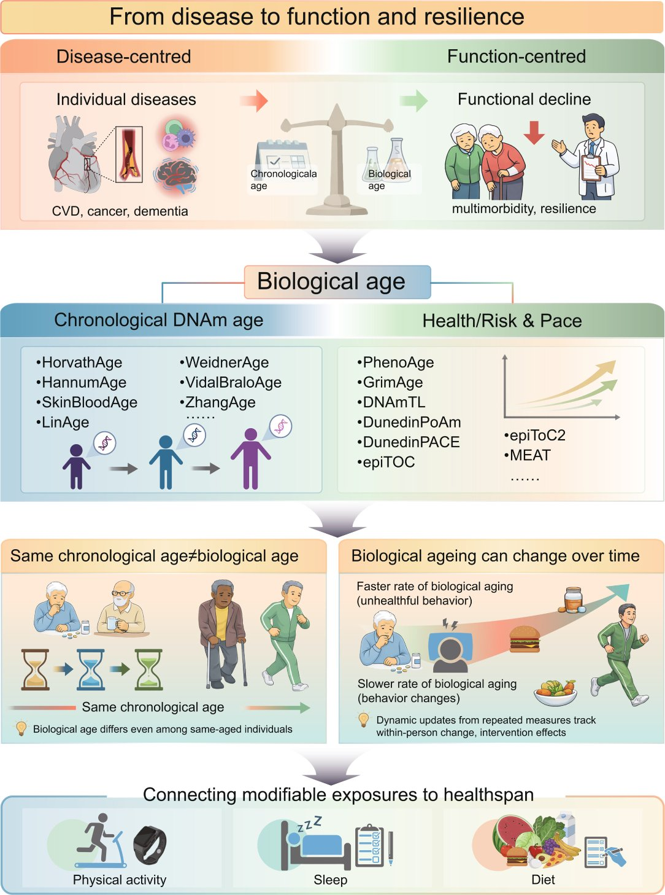

# The Big Picture

**In one line:** your *biological* age — how old your body acts, measured from blood, DNA marks, proteins, metabolites or gut bacteria — is a better target for healthy ageing than your birthday, and the three habits with the most evidence for moving it are **physical activity, sleep and diet**.

*Figure 1 from the paper (CC BY 4.0).*

## The paper's argument in five steps

1. **Medicine is shifting** from treating single diseases to protecting function and resilience. People the same age differ hugely in decline, illness and survival, and calendar age can't explain why. → [What Is Biological Age?](concepts/what-is-biological-age.md)
2. **Biological age can now be measured** with several kinds of "clocks": blood-test clocks, DNA-methylation clocks, protein and metabolite clocks, and gut-microbiome clocks. → [The Four Kinds of Clocks](concepts/clock-types.md)
3. **It makes a better endpoint** because it predicts disability, frailty, multimorbidity and death better than calendar age, reacts to lifestyle, and can be re-measured to track change. → [Why Use Biological Age](concepts/why-biological-age.md)
4. **Research exploded after 2017 and again after 2023**, and the biggest lifestyle themes are physical activity, sleep and diet. → [Research Map](concepts/knowledge-map.md)
5. **Each habit links to a younger biological age**, probably through inflammation, metabolism and oxidative stress. The three work together. → [Activity](concepts/physical-activity.md) · [Sleep](concepts/sleep.md) · [Diet](concepts/diet.md) · [Together](concepts/combined-lifestyle.md)

## What the paper does *not* claim

- It doesn't present new trial results. It's a review plus a map of the literature.
- It says **no single clock captures whole-body ageing**.
- It says the causal evidence for sleep and activity is **still evolving**. Most findings are associations.
